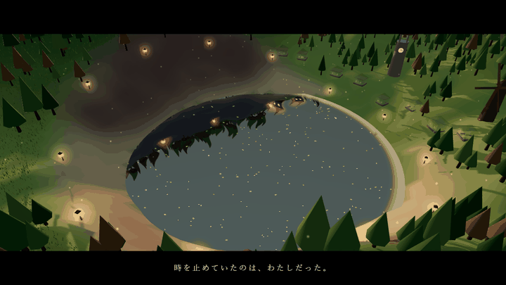
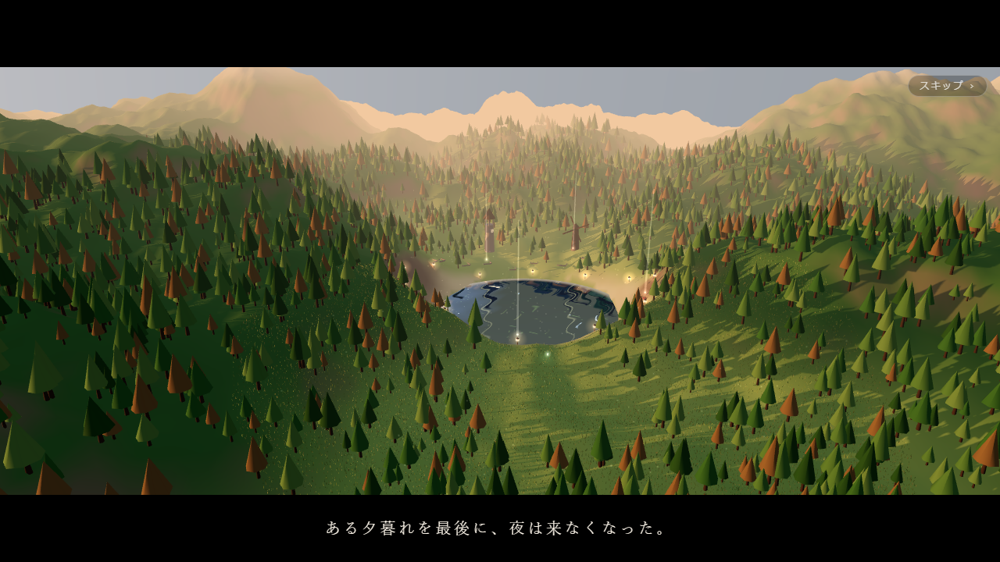
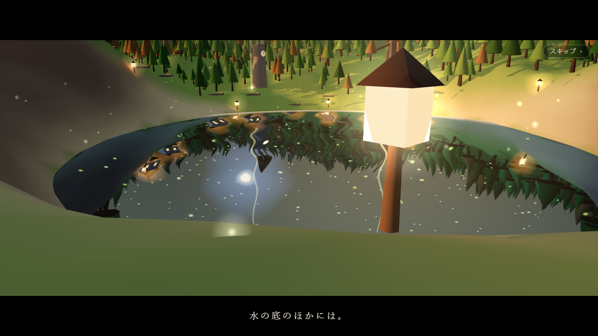
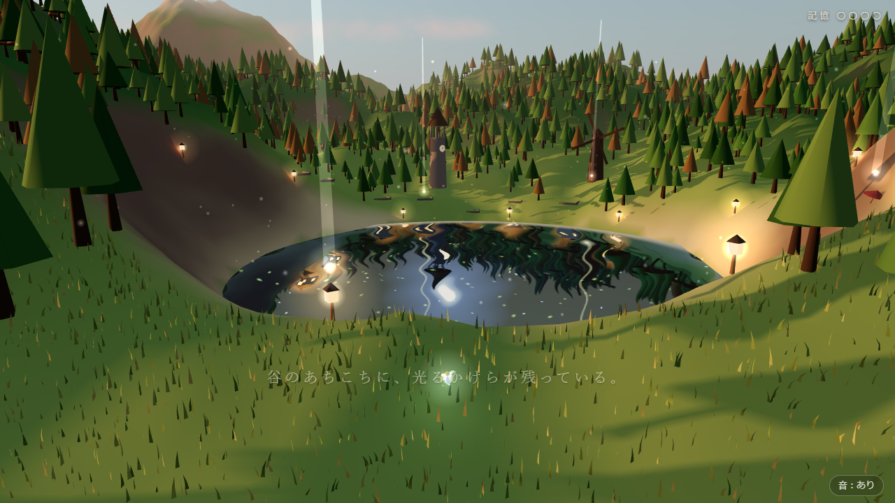
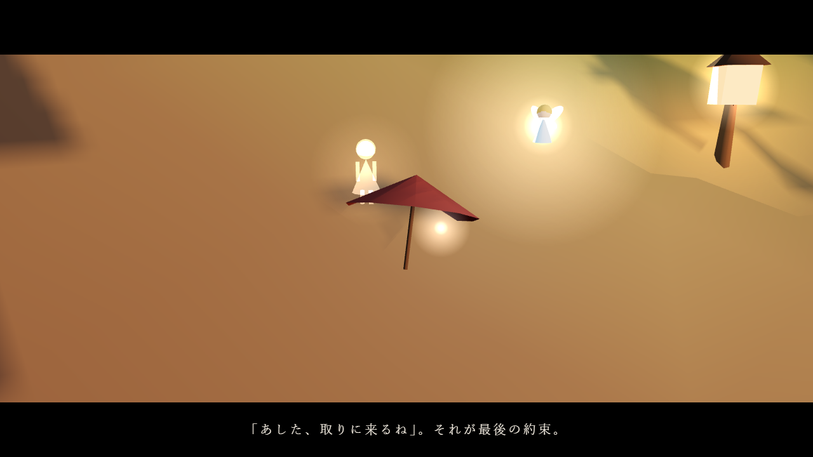
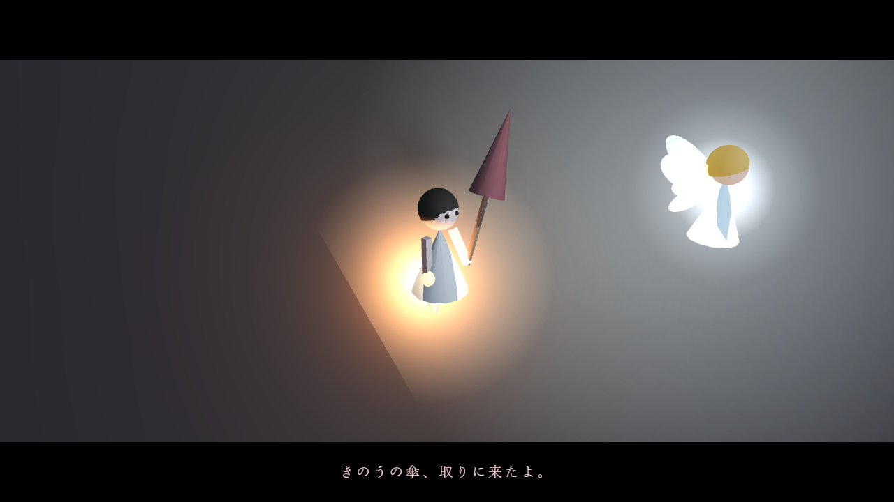
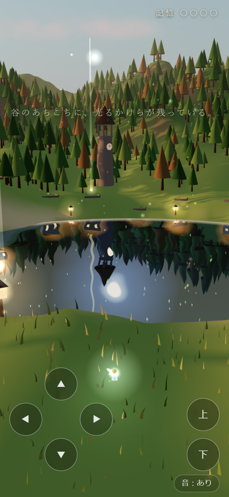

<h1 align="center">終わらない黄昏の谷</h1>

<p align="center"><a href="README.md">English</a> | <b>日本語</b></p>

<p align="center">
  <b>この谷に、夜は来ない。水の底のほかには。<br>
  妖精になって、谷に残った記憶を集める、ブラウザで遊べる6分ほどの物語。</b>
</p>

<p align="center">
  <a href="https://futurecortexlabs.github.io/FCTX_Beautiful_Scenery/"><b>▶ 遊んでみる</b></a>
  &nbsp;·&nbsp;
  <a href="#仕組み">仕組み</a>
  &nbsp;·&nbsp;
  <a href="#既知の限界">既知の限界</a>
</p>

<p align="center">
  
</p>

<p align="center">
  <sub>
  鐘が鳴ると、止まっていた時間が動きだし、こちら側の谷にも約26秒かけて夜が降りてきます。それまで夜は湖の映り込みの中にしかありません。ヘッドレスブラウザで実際に最後まで遊んで録画したもので、2倍速です。
  </sub>
</p>

---

## これは何か

夕暮れのまま時間が止まった谷を、妖精になって飛ぶ短い物語です。湖の水面にだけ、来なくなった夜が映っています。灯籠、赤い傘、パン屋の跡、風車に残った4つの「記憶のかけら」を集めると、止まっていた鐘楼の鐘が鳴らせるようになります。

谷・木・草・村・人影・音はすべてコードで生成しています。画像やモデル、音声ファイルは使っていません。

| 操作 | 起きること |
|:--|:--|
| **はじめる** | 空の高みから谷へ、湖の中の夜へと降りていくプロローグ。右上の「スキップ」で飛ばせる |
| **妖精を飛ばす** | 光るかけらに近づくと拾える。拾うたびに、その場所の記憶が光る人影になって浮かび、妖精の光が少しあたたかくなる |
| **4つ集める** | 鐘楼へ導く光が立つ。集める前に鐘に近づいても、鐘はまだ鳴らない |
| **鐘を鳴らす** | 時計が動きだし、谷に夜が来る。水の底の夜から、あの子が傘を取りに来る |
| **そのあと** | エンドロールのあとも、夜の谷を飛びつづけられる |

<table>
<tr>
<td width="50%"></td>
<td width="50%"></td>
</tr>
<tr>
<td></td>
<td></td>
</tr>
<tr>
<td></td>
<td align="center"></td>
</tr>
</table>

---

## 遊ぶ

- **オンライン**：[futurecortexlabs.github.io/FCTX_Beautiful_Scenery](https://futurecortexlabs.github.io/FCTX_Beautiful_Scenery/)（英語版は [`/en/`](https://futurecortexlabs.github.io/FCTX_Beautiful_Scenery/en/)）
- **手元で**：ES モジュールを使っているので、`index.html` を直接開くのではなく、ローカルサーバー経由で開いてください。初回は unpkg から Three.js を読み込むためネット接続が必要です。

  ```bash
  python -m http.server 8765
  ```

  起動したら `http://localhost:8765/` を開きます。
- **言語**：開始画面の右上の「English」で英語版（`en/`）に切り替わります。

音が出ます。WebGL が動く今のブラウザ（Chrome、Edge、Safari、Firefox）なら、パソコンでもスマホでも動きます。

| 操作 | パソコン | スマホ |
|:--|:--|:--|
| **移動** | WASD か矢印キー | 画面左下の ▲◀▶▼ |
| **上昇・下降** | Space / E で上昇、Shift / Q で下降 | 画面右下の「上」「下」 |
| **視点** | ドラッグで回転、ホイールでズーム | ドラッグで回転、ピンチでズーム |
| **音** | 右下の「音：あり／なし」 | 同じ |

しばらく操作しないと、視点がゆっくり谷を巡りはじめます（OS で「視差効果を減らす」を有効にしている場合は巡りません）。

---

## 仕組み

ビルドはありません。`index.html` が import map で Three.js r160 を unpkg から読み込み、`app.js` がすべてを組み立てます。

```
毎フレーム（setAnimationLoop、時間刻みは最大 50 ms）
  |
  +- 妖精      入力 -> 速度 -> 移動、羽ばたき、通ったあとに残る光の粉
  +- 物語      かけらとの距離判定 -> 回想の場面 -> 鐘 -> 夜の深さ k（0 = 黄昏、1 = 夜）
  +- 結末      水の底から来るあの子の歩き・傘・手を振る動き
  +- 演出      場面（shot）を順に流す。暗転で切り替え、カメラはドリーと周回
  +- 世界      k に合わせて太陽・霧・光・雲・蛍・星と月を補間
  +- 描画      Three.js：Sky、影つきの夕陽、湖の Reflector
```

### 水の底にだけある夜

湖は Three.js の `Reflector` です。映り込みを描く直前に世界をいったん「夜」（k = 1）に切り替え、描き終えたら「黄昏」に戻しています。

```
lake.onBeforeRender = () => {
  applyWorld(1, true)        太陽を沈め、霧と光を夜の色に、星・月・村を表示
  映り込みを描く
  applyWorld(k, false)       こちらの世界に戻す（鐘が鳴るまでは k = 0）
}
```

灯りのともる村や星と月は `mirrorWorld` というグループに入っていて、こちら側では、鐘が鳴るまで透明度 0 です。だから水面にだけ、来なかった夜の谷が映ります。鐘が鳴ると、それらがこちら側にも少しずつ浮かび上がります。鐘楼の時計も、水の中では動き続け、こちらでは鐘が鳴るまで止まったままです。映り込みはさざ波でゆらし、岸に近いほど浅瀬の色になじませています。

### 谷をつくるもの

| 要素 | 作り方 |
|:--|:--|
| **地形** | 2000 × 2000 の平面を 360 分割し、値ノイズの fBm で起伏をつけ、湖のところをくぼませる。高さと傾きで砂・草地・森・岩・雪の頂点色を塗り分け |
| **空** | Three.js の `Sky`（大気散乱）。太陽高度 5° の夕暮れ |
| **木** | `InstancedMesh` で 3500 本。草原から湖への視線の通り道、村の跡、風車のまわりは避けて植える。葉は頂点シェーダで風に揺れる |
| **草** | 見る人の立つ草原だけに 45,000 本（スマホは 22,000 本） |
| **光の粒** | 夕陽を受けて漂う花粉 1200 粒。夜になると蛍の色になる |
| **人影** | 円柱・球・円錐・箱で組んだ人の形。回想の光る人影にも、結末のあの子にも使う |

### 音

すべて Web Audio でその場で合成しています。赤みがかったノイズを帯域フィルタに通した風、かけらを拾ったときのチャイム、鐘の音、夜が来たあとのやわらかな和音と虫の声、場面の合間の短い旋律です。ブラウザは操作のあとでないと音を出せないので、「はじめる」を押したときに音を鳴らし始めます。

---

## 検証

ヘッドレスの Chrome（GPU 描画）で確認しました。

- 日本語版・英語版の両方を、1280 × 720 で最初から最後まで自動で遊び、プロローグ・4つの回想・鐘・夜・結末・エンドロール後の自由飛行まで進むこと。
- 390 × 844 のスマホサイズ（タッチ端末として）でも同じく最後まで進むこと。
- そのあいだ、コンソールエラーが出ないこと。

この README のスクリーンショットと GIF は、そのときに撮ったものです。確認に使ったスクリプトはリポジトリに入っておらず、自動テストもありません。

---

## 性能

| | |
|:--|:--|
| サイズ | コードは `app.js` 約 79 KB、`style.css` 約 6 KB、HTML 2つで約 8 KB。ほかに SNS 用のカード画像 2 枚 |
| 通信 | unpkg から Three.js r160 本体と `OrbitControls`・`Sky`・`Reflector` |
| スマホ | ピクセル比の上限 1.5（パソコンは 2）、草の本数を半分に。操作パッドを表示し、物語の文を画面中央寄りに出す |
| フレームレート | 実機ではまだ測っていない |

---

## 既知の限界

- **当たり判定は簡易です**。妖精は地面（と水面）から 0.8 より下には潜らず、高さ 140・中心から ±600 の範囲に収まりますが、木や建物はすり抜けます。
- **かけらと鐘は距離で判定しています**。近づけば拾え、見えていなくても届けば反応します。
- **夜に変わるのは光の色と強さです**。空の太陽は沈みますが、影を落とす光の向きは夕陽のまま変わりません。
- **ファイルを直接開くと動きません**。ES モジュールと import map を使っているので、ローカルサーバーが必要です。
- **初回はネット接続が必要です**。Three.js を CDN から読み込んでいます。

---

## ファイル構成

| パス | 中身 |
|:--|:--|
| [`index.html`](index.html) | 日本語版のページ（SNS 用のカード、開始画面、エンドロール） |
| [`en/index.html`](en/index.html) | 英語版のページ |
| [`app.js`](app.js) | 本体。谷、湖、妖精、物語、演出、音、両言語の文言 |
| [`style.css`](style.css) | 字幕、開始画面、エンドロール、スマホ用の操作パッド |
| [`og.jpg`](og.jpg), [`en/og.jpg`](en/og.jpg) | SNS でリンクを貼ったときのカード画像（1200 × 630） |
| [`docs/media/`](docs/media) | この README のスクリーンショットと GIF |
| [`README.md`](README.md) | 英語版の README |

---

## ライセンス

[Apache License 2.0](LICENSE)

Three.js（MIT ライセンス）は実行時に unpkg から読み込んでおり、このリポジトリには含めていません。
