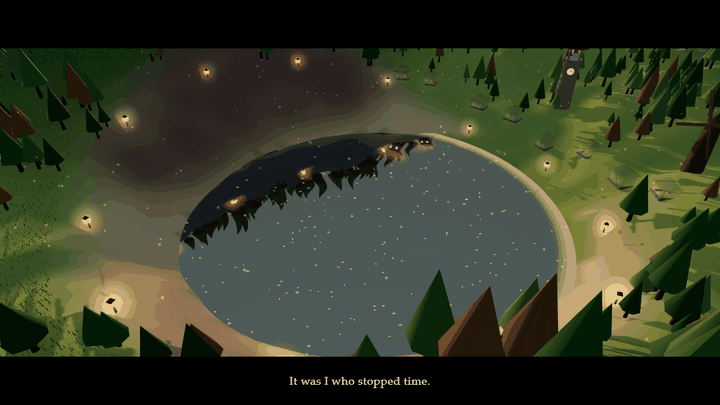
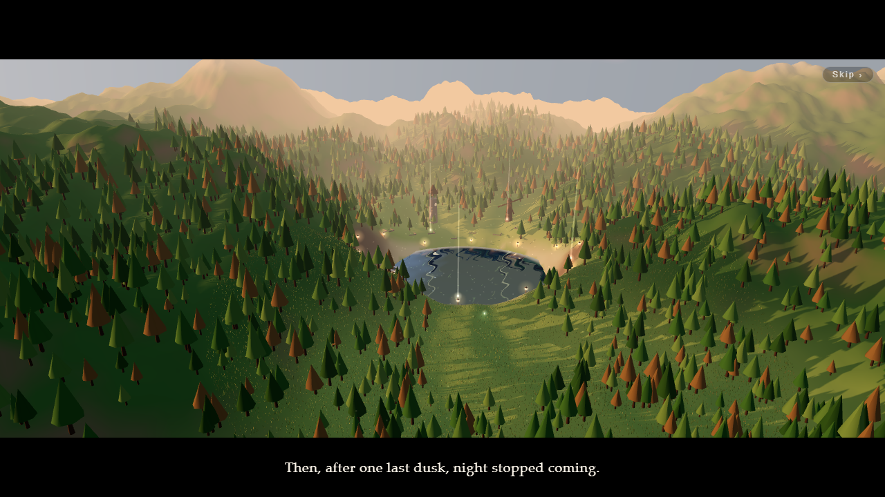
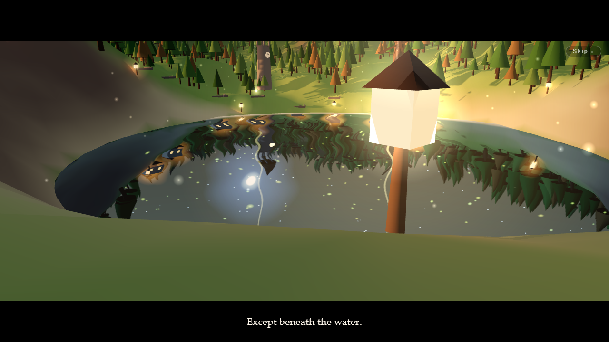
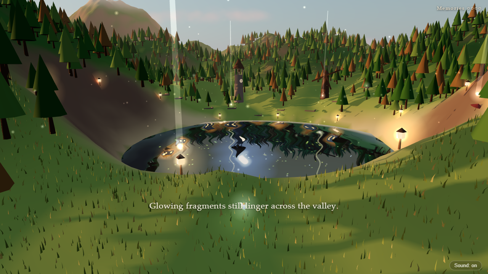
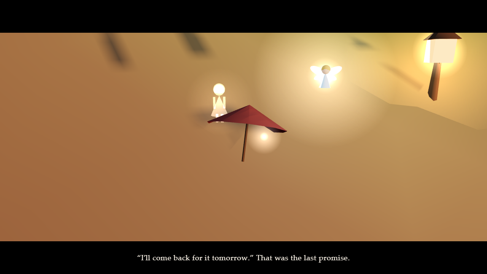
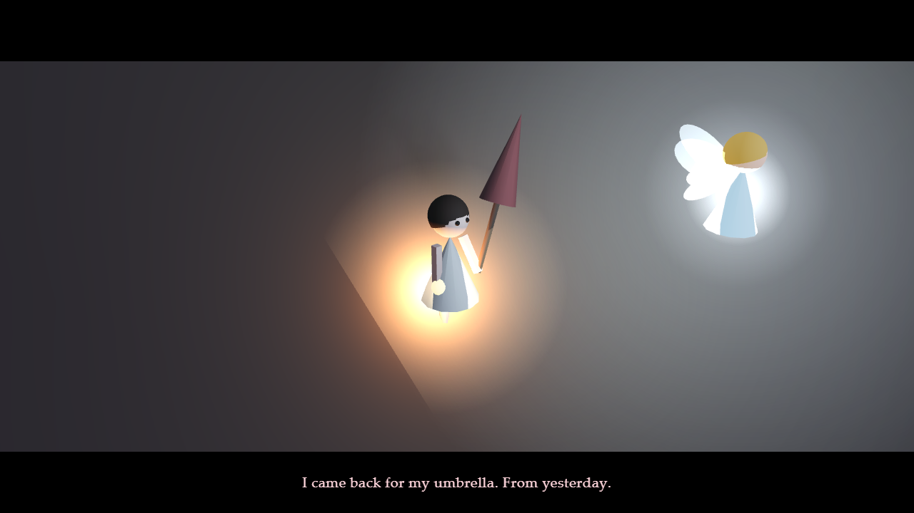
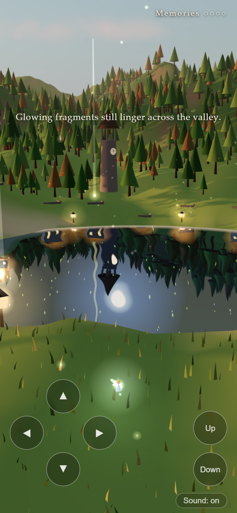

<h1 align="center">The Valley of Endless Dusk</h1>

<p align="center"><b>English</b> | <a href="README.ja.md">日本語</a></p>

<p align="center">
  <b>Night never comes to this valley. Except beneath the water.<br>
  Become a fairy and gather the memories left behind, in a six-minute story that runs in the browser.</b>
</p>

<p align="center">
  <a href="https://futurecortexlabs.github.io/FCTX_Beautiful_Scenery/en/"><b>▶ Play it</b></a>
  &nbsp;·&nbsp;
  <a href="#how-it-works">How it works</a>
  &nbsp;·&nbsp;
  <a href="#known-limits">Known limits</a>
</p>

<p align="center">
  
</p>

<p align="center">
  <sub>
  When the bell rings, the stopped clock starts again and night settles over the valley across about 26 seconds. Until then, night exists only in the lake's reflection. Recorded by playing the story to the end in a headless browser, shown at 2×.
  </sub>
</p>

---

## What it is

A short story about a valley where time stopped at dusk. You fly a fairy over it. Only the surface of the lake still shows the night that stopped coming. Four "fragments of memory" are left at a lantern, a red umbrella, the ruins of a bakery and a windmill. Gather them, and the bell in the stopped clock tower can ring again.

The valley, trees, grass, village, figures and sound are all generated in code. There are no image, model or audio files.

| What you do | What happens |
|:--|:--|
| **Begin** | A prologue descends from high above the valley into the night inside the lake. **Skip** at the top right jumps past it |
| **Fly the fairy** | Fly close to a glowing fragment to pick it up. Each one replays the memory of that place as glowing figures, and the fairy's own light grows a little warmer |
| **Gather all four** | A beam of light rises over the clock tower. Visit the bell earlier and it will not ring yet |
| **Ring the bell** | The clock starts, night comes to the valley, and the child comes back up from the night under the water for the umbrella |
| **Afterwards** | After the credits you can keep flying through the valley at night |

The English version lives at [`/en/`](https://futurecortexlabs.github.io/FCTX_Beautiful_Scenery/en/); the Japanese original is at the root. Each has a link to the other on the start screen.

<table>
<tr>
<td width="50%"></td>
<td width="50%"></td>
</tr>
<tr>
<td></td>
<td></td>
</tr>
<tr>
<td></td>
<td align="center"></td>
</tr>
</table>

---

## Play it

- **Online:** [futurecortexlabs.github.io/FCTX_Beautiful_Scenery/en](https://futurecortexlabs.github.io/FCTX_Beautiful_Scenery/en/) (Japanese at the [root](https://futurecortexlabs.github.io/FCTX_Beautiful_Scenery/))
- **Locally:** the page uses ES modules, so serve the folder instead of opening `index.html` from disk. It needs an internet connection the first time, to load Three.js from unpkg.

  ```bash
  python -m http.server 8765
  ```

  Then open `http://localhost:8765/en/`.

It plays sound. Any current browser with WebGL works (Chrome, Edge, Safari, Firefox), on desktop or phone.

| | Desktop | Phone |
|:--|:--|:--|
| **Move** | WASD or arrow keys | ▲◀▶▼ pad at bottom left |
| **Up / down** | Space or E to rise, Shift or Q to sink | Up / Down buttons at bottom right |
| **Camera** | Drag to orbit, scroll to zoom | Drag to orbit, pinch to zoom |
| **Sound** | Sound on / off at bottom right | Same |

Leave it alone for a while and the camera starts circling the valley on its own. It does not if the system is set to reduce motion.

---

## How it works

There is no build step. `index.html` loads Three.js r160 from unpkg through an import map, and `app.js` builds everything.

```
every frame (setAnimationLoop, time step capped at 50 ms)
  |
  +- fairy      input -> velocity -> position, wing flaps, a trail of glowing dust
  +- story      distance to fragments -> memory scenes -> bell -> night depth k (0 = dusk, 1 = night)
  +- ending     the child's walk from the water, the umbrella, the wave
  +- director   plays shots in order: cuts through black, dolly and orbit cameras
  +- world      sun, fog, lights, clouds, fireflies, stars and moon blended by k
  +- render     Three.js: Sky, a shadow-casting low sun, a Reflector for the lake
```

### Night only beneath the water

The lake is a Three.js `Reflector`. Just before the reflection is drawn, the whole world is switched to night (k = 1), and switched back to dusk right after.

```
lake.onBeforeRender = () => {
  applyWorld(1, true)        sun down, night fog and light, show stars, moon and village
  draw the reflection
  applyWorld(k, false)       back to this side (k = 0 until the bell rings)
}
```

The lit village, the stars and the moon sit in a group called `mirrorWorld`, which stays fully transparent on this side until the bell rings. So the night valley that never came appears only on the water. Once the bell rings, it fades in on this side too. The clock tower works the same way: in the water its hands keep moving; up here they stay stopped until the bell rings. The reflection is rippled, and blended towards a shallow-water colour near the shore.

### What the valley is made of

| Part | How |
|:--|:--|
| **Terrain** | A 2000 × 2000 plane in 360 × 360 segments, raised with value-noise fBm and hollowed out for the lake. Vertex colours for sand, meadow, forest, rock and snow by height and slope |
| **Sky** | Three.js `Sky` (atmospheric scattering), with the sun 5° above the horizon |
| **Trees** | 3,500 in an `InstancedMesh`, kept off the line of sight from the meadow to the lake, the village site and the windmill. A vertex shader sways the leaves in the wind |
| **Grass** | 45,000 blades (22,000 on phones), only in the meadow where the viewer stands |
| **Motes** | 1,200 grains of pollen drifting in the low sun, turning into fireflies at night |
| **Figures** | People built from cylinders, spheres, a cone and boxes. Used for the glowing figures in the memories and for the child at the end |

### Sound

Everything is synthesized on the spot with Web Audio: wind from reddish noise through a band-pass filter, a chime for each fragment, the bell, a soft chord and insects once night comes, and a short motif between scenes. Browsers only allow sound after a user gesture, so it starts when you press Begin.

---

## Verification

Checked in headless Chrome with GPU rendering:

- The Japanese and English versions were each played automatically from start to finish at 1280 × 720: the prologue, all four memories, the bell, nightfall, the ending, and free flight after the credits.
- The same full run at 390 × 844 as a touch device.
- No console errors in any of those runs.

The screenshots and GIF in this README come from those runs. The script that drove them is not part of this repository, and there is no automated test suite.

---

## Performance

| | |
|:--|:--|
| Size | About 79 KB of `app.js`, 6 KB of `style.css` and 8 KB for the two HTML pages, plus two share-card images |
| Network | Three.js r160 with `OrbitControls`, `Sky` and `Reflector` from unpkg |
| Phones | Pixel ratio capped at 1.5 (2 on desktop) and half the grass. The control pad appears and story lines move towards the centre of the screen |
| Frame rate | Not measured on real hardware yet |

---

## Known limits

- **Collision is minimal.** The fairy stays at least 0.8 above the ground or the water, below a height of 140 and within ±600 of the centre, but it passes through trees and buildings.
- **Fragments and the bell trigger by distance.** Get close enough and they react, whether or not they are in view.
- **Nightfall changes the colour and strength of the light.** The sun in the sky sets, but the shadow-casting light keeps its dusk direction.
- **Opening the file directly does not work.** ES modules and the import map need a local server.
- **The first load needs a connection.** Three.js comes from a CDN.

---

## Repository

| Path | Contents |
|:--|:--|
| [`index.html`](index.html) | The Japanese page: share card, start screen, credits |
| [`en/index.html`](en/index.html) | The English page |
| [`app.js`](app.js) | The whole experience: valley, lake, fairy, story, direction, sound, and the text in both languages |
| [`style.css`](style.css) | Captions, start screen, credits, and the phone control pad |
| [`og.jpg`](og.jpg), [`en/og.jpg`](en/og.jpg) | Share-card images for social posts (1200 × 630) |
| [`docs/media/`](docs/media) | The screenshots and GIF used in this README |
| [`README.ja.md`](README.ja.md) | This README in Japanese |

---

## Licence

[Apache License 2.0](LICENSE)

Three.js (MIT licence) is loaded at runtime from unpkg and is not redistributed in this repository.
